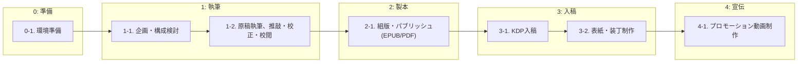

# KDP出版支援ツール&手順書

Markdown原稿から、Amazon KDP出版用の電子書籍（EPUB）および紙書籍（ペーパーバック用PDF）を生成でき、プロモーション用縦書きショート動画の録画ツールも同梱した出版テンプレートです。

---

## 出版ワークフロー

本テンプレートを用いた書籍制作は、以下の5つのステップで進めます。



---

## ワークフローごとの手順

### Step 0: 🐋準備

> [!NOTE]
> 本テンプレートで提供するツールは、`bash(sh)` および `Docker` が必須です。
> また、AIによる作業支援も手順に含まれますが、こちらは人力で代用可能です（その場合はプロンプトを執筆手順として読み替えてください）。

PandocおよびLaTeXによる組版、動画録画サーバーをローカル環境に依存せず実行するため、Dockerイメージをビルドします（初回のみ）。

```sh
# リポジトリルートで実行
docker build -t book-pandoc .
```


### Step 1: ✍️執筆

> [!NOTE]
> 書籍のテーマ、校正を、AIと壁打ちしながら検討し、書籍の執筆を行ないます。
> 推敲、校正、校閲もAIがサポートします。

**ここで行う作業：**
- 1-1. 企画・構成検討
  - [書籍執筆手順書#1-1. 企画・構成の検討（AI壁打ち）](book/README.md#1-1.%20企画・構成の検討（AI壁打ち）) `book/README.md`
- 1-2. 原稿執筆、推敲・校正・校閲
  - [書籍執筆手順書#1-2. 原稿執筆と推敲・校正・校閲](book/README.md#1-2.%20原稿執筆と推敲・校正・校閲) `book/README.md`


### Step 2: 📖製本

> [!NOTE]
> 執筆した原稿を、書籍データ（EPUB、PDF）に変換します。
> 版型その他の調整もここで行います。

**ここで行う作業：**
- 2-1. 組版・パブリッシュ(EPUB/PDF)
  - [製本・組版手順書](bin/README.md) `bin/README.md`


### Step 3: 📦入稿

> [!NOTE]
> KDPに出版の申請を行います。
> 説明文章やタグ、表紙も必要になるので、併せて準備します。

**ここで行う作業：**
- 3-1. KDP入稿
  - [KDP入稿手順 ＆ 出版登録シート](submission.md) `submission.md`
- 3-2. 表紙・装丁制作
  - [表紙・装丁制作手順書](book/cover/README.md) `book/cover/README.md`


### Step 4: 📢宣伝

> [!NOTE]
> 書籍宣伝のための、ショート動画を作成します。
> この作業は任意ですし、宣伝方法は他にも多々ありますが、手間の大きい動画制作だけ、ツールを提供します。

**ここで行う作業：**
- 4-1. プロモーション動画制作
  - [プロモーション動画制作手順書](book/promote/README.md) `book/promote/README.md`

