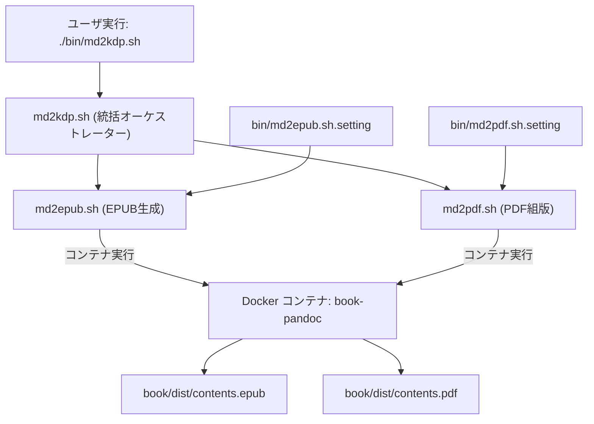
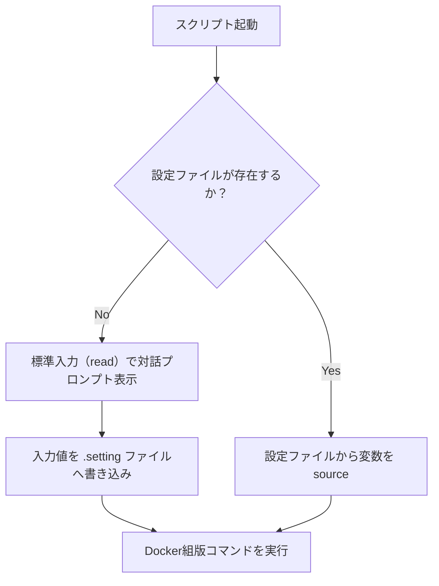

# 変換スクリプト・パイプライン仕様 (bin/specification.md)

本ドキュメントは、Markdown原稿からEPUB（電子書籍）およびPDF（ペーパーバック用）を生成する自動ビルドパイプライン、Pandoc/LaTeX呼び出し引数仕様、設定永続化メカニズム、およびDocker実行コンテキストに関する技術仕様書です。


## 1. ビルドオーケストレーションアーキテクチャ

スクリプト群は、単一のマスター原稿からターゲット別のビルドを独立して実行できるよう、疎結合なモジュール設計を採用しています。



### 終了ステータスとエラーハンドリング
- すべてのスクリプトは `set -e`（未補足エラー発生時の即時終了）を有効にしています。
- `md2kdp.sh` は、前段の `md2epub.sh` が終了コード 0 以外を返した場合、後段の `md2pdf.sh` を実行せず即座に異常終了します。


## 2. Pandoc 実行コマンド詳細仕様

### 2.1 EPUB 生成コマンド (`bin/md2epub.sh`)

```sh
docker run --rm -v "$(pwd):/workspace" -w /workspace book-pandoc \
  "$markdown_file" \
  -o "$output_file" \
  --metadata-file="$metadata_yaml" \
  --epub-cover-image="$cover_image" \
  --css="$css_file" \
  --toc \
  --toc-depth=2 \
  --split-level=1
```

| 引数・オプション | 役割と技術的根拠 |
|:---|:---|
| `"$markdown_file"` | 入力Markdownファイル。共通規格ASTへパースされる。 |
| `-o "$output_file"` | 出力先EPUBファイルパス（`book/dist/` 配下）。 |
| `--metadata-file` | Dublin Core準拠のタイトル、著者名、言語（`ja`）等を注入。 |
| `--epub-cover-image` | EPUB標準パッケージ規格に準拠した表紙画像（`cover.png`）を埋め込み。 |
| `--css` | 縦書き・右開き用スタイルシート（`epub.css`）をEPUB内にバンドル。 |
| `--toc` | EPUBの論理目次（`nav.xhtml` および NCX）を自動生成。 |
| `--toc-depth=2` | 目次に含める階層をレベル2（章・節）までに制限。 |
| `--split-level=1` | レベル1見出し（章）ごとに内部HTMLファイルを分割（リーダーの読込性能を最適化）。 |

### 2.2 PDF（LuaLaTeX）生成コマンド (`bin/md2pdf.sh`)

```sh
docker run --rm -v "$(pwd):/workspace" -w /workspace book-pandoc \
  "$markdown_file" \
  -o "$output_file" \
  --pdf-engine=lualatex \
  --metadata-file="$metadata_yaml" \
  --lua-filter="filters/ruby.lua" \
  --top-level-division=chapter \
  --toc \
  --toc-depth=2
```

| 引数・オプション | 役割と技術的根拠 |
|:---|:---|
| `--pdf-engine=lualatex` | 日本語組版エンジンとしてLuaLaTeXを指定（OpenType/TrueType直接読み込み）。 |
| `--metadata-file` | `jlreq` クラスオプション（A5、縦書き、マージン設定等）を注入。 |
| `--lua-filter` | AST走査時にHTMLルビをLaTeX `\ruby` マクロへ変換し、目次・しおりの文字化けを防止。 |
| `--top-level-division=chapter` | レベル1見出しを `\chapter`（章）として扱い、左ページ（偶数ページ）起こしを適用。 |
| `--toc` / `--toc-depth=2` | LaTeXの二段組版による正確なページ番号付き目次を生成。 |


## 3. 設定永続化仕様 (`.setting`)

スクリプトはCLI引数なしで実行できるよう、設定ファイルによる自動バインディング機構を備えています。



### 設定ファイルのフォーマット
設定ファイル（`bin/*.setting`）は、POSIXシェル互換のキー・バリュー形式（Bashの `source` 可能な構文）で保存されます。

```sh
# md2epub.sh.setting の例
markdown_file="book/contents.md"
metadata_yaml="book/metadata-epub.yaml"
cover_image="book/cover/cover.png"
css_file="book/epub.css"
```


## 4. Dockerコンテナ実行基盤仕様

- **作業ディレクトリの統一**: `-w /workspace` により、全パスの起点をプロジェクトルートに固定。
- **再現性の保証**: ホストマシンのTeXLiveインストール状況、OSフォントキャッシュに一切依存せず、常に完全に同一のバイナリ（PDF/EPUB）を再現可能。
