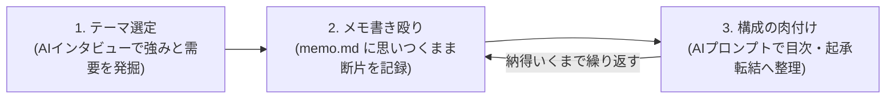

# 書籍執筆手順書 (book/README.md)

> [!NOTE]
> 書籍の執筆は、最も深く頭を使うクリエイティブなプロセスです。
> 最初から完璧な文章を書こうとせず、AIを「思考の壁打ち相手」として活用しながら、頭の中の知識や経験を整理し、段階的に原稿へと昇華させていきます。
> 詳しいデータ仕様や設定項目については、[specification.md](./specification.md) を参照してください。

## 1-1. 企画・構成の検討（AI壁打ち）

書籍執筆のコツは、「自分が書きたいこと」をそのまま書くのではなく、**「世間が求めている課題や悩みのうち、自分の経験や能力で解決できる事柄」** をテーマに選定することです。
次の思考サイクルで、あなたにしか書けない書籍の骨格を固めましょう。

### 1. **テーマの選定（AIインタビュー）**:
   - [prompt.md の「執筆テーマ検討」](./prompt.md#執筆テーマ検討) プロンプトをAI（Claude / ChatGPT等）に投入します。
   - AIからの質問に答えながら、自身のスキル・実体験と、世間の悩み・ニーズが交差する独自の切り口を見つけ出します。
### 2. **インスピレーションの書き殴り**:
   - 壁打ちで得た気付きや伝えたいメッセージを、[memo.md](./memo.md) に書き殴ります。
   - 文章の体裁を整える必要はありません。断片的な箇条書きやキーワードのままで構いません。
### 3. **目次・構成の整理と肉付け**:
   - [prompt.md の「メモの整理と肉付け」](./prompt.md#メモの整理と肉付け) プロンプトをAIに投入し、[memo.md](./memo.md) を起承転結のある章立て構成案へ並べ直させます。
   - 不足している論点や具体例があれば 2 に戻って書き足し、納得のいく目次ができるまで繰り返します。

## 1-2. 原稿執筆と推敲・校正・校閲

整理した構成メモ（`memo.md`）をガイドにして、[contents.md](./contents.md) に本文を執筆します。

> [!TIP]
> 執筆中に筆が止まったり、話の方向性が見失われそうになったら、無理に本文を書き進めず、一度 [memo.md](./memo.md) や目次構成に戻って頭を整理し直すのがスムーズに進める秘訣です。

### AIによる推敲・校正・校閲
初稿がまとまったら、[prompt.md](./prompt.md) に収録された以下のプロンプトを活用し、多角的に原稿の完成度を高めます：

1. **[誤字脱字・言い回しの校正](./prompt.md#誤字脱字言い回しの校正)**:
   - 1文単位で精査し、確信度（◎・〇・△）付きで誤字・脱字・意味の通りにくい表現を検出します。
2. **[章・段落の主張と論理構成の確認](./prompt.md#章段落の主張と論理構成の確認)**:
   - 各章の主張が首尾一貫しているか、書籍全体の結論に向けて論理の飛躍がないかを客観的にチェックします。
3. **[文体・トーンの推敲](./prompt.md#文体トーンの推敲)**:
   - 「親しみやすい語り口」「論理的な解説調」「格調高い文体」など、目指す作風に合わせて語尾や言い回しを統一します。

> [!TIP]
> [prompt.md の「難読漢字への読み仮名付与」](./prompt.md#難読漢字への読み仮名付与下準備) プロンプトで（人間に読みやすい）`漢字（かんじ）`形式の読み仮名を自動付与できます。
> ある程度執筆が出来上がったら、[prompt.md の「読み仮名のHTMLルビ化」](./prompt.md#読み仮名のhtmlルビ化) プロンプトで、`漢字（かんじ）`形式を（Markdownで認識できる）`<ruby>漢字<rt>かんじ</rt></ruby>`形式に変換できます。

---

## 次のステップ

原稿の執筆と推敲が完了したら、次は **[Step 2: 製本（組版・パブリッシュ）](../bin/README.md)** に進み、電子書籍（EPUB）と紙書籍用PDFを一括生成します。