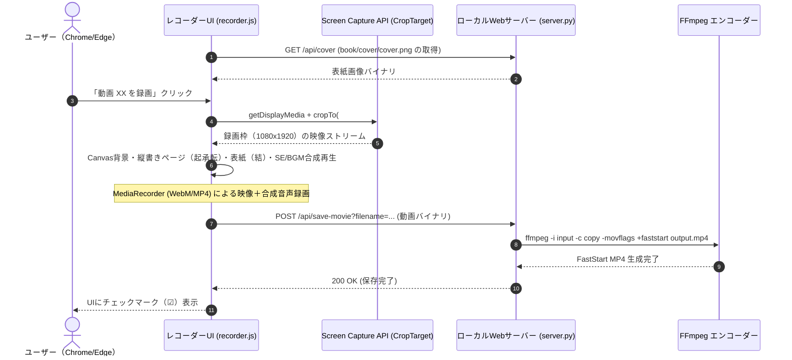

# プロモーション動画システム仕様 (book/promote/specification.md)

本ドキュメントは、書籍宣伝用縦型ショート動画レコーダーのクライアント・サーバーアーキテクチャ、レンダリング幾何学、1文1ページ（起・承・転・結）タイムライン制御、Web Audio音響合成、Web API仕様、および動画エンコーディングパイプラインに関する技術仕様書です。


## 1. システムアーキテクチャ概要

本ツールは、HTML5/CSS/Canvasの表現力（縦書き・ルビ組版・表紙カラーを踏襲した動的背景・時間差テキスト演出）とWeb Audio API（内蔵シンセサイズ効果音＋BGM合成）を活かしたショート動画を、ブラウザ完結で高画質にキャプチャし、ローカルサーバー経由でFastStart MP4へ自動変換するシステムです。




## 2. レンダリング幾何学＆タイムライン仕様

### 2.1 録画枠（Stage Frame）の座標系
- **基準解像度**: $1,080 \times 1,920$ ピクセル（アスペクト比 9:16、フルHD縦型規格）
- **ビューポート適応（`fitStage`）**:
  ブラウザの表示領域に合わせて、以下のスケーリングファクターで `#stage-frame` を縮小・中央配置します（録画時は元のアスペクト比を維持してキャプチャ）。
  $$\text{scale} = \min\left(\frac{\text{window.innerWidth} - 360}{1080}, \frac{\text{window.innerHeight}}{1920}, 1.0\right)$$

### 2.2 背景プリセット描画エンジン（Canvas）
`window.BOOK_CONFIG.theme` に定義されたカラーパレット（`baseColor`, `subColor`, `textColor`, `accentColor`, `phase4Shade`）と `preset` に基づき、$1,080 \times 1,920$ の `<canvas id="bg-canvas">` 上で動的背景をリアルタイム描画します。

- **`washi`（和紙・布目調）**: オフスクリーンCanvasに縦糸・横糸の織り目と紬の節（スラブ）を生成してキャッシュし、毎フレーム緩やかに揺らぐ放射グラデーションと陽だまりレイヤーの上に合成します。
- **`modern`（知的グラデーション＋微粒子）**: 角度が緩やかに変化する線形グラデーション上に、`accentColor` の微粒子パーティクルを浮遊させます。
- **`classic`（重厚ビネット）**: 周辺減光と粒状グレインの中で中央のスポットライトが静かに呼吸する演出を行います。
- **`video`（動画背景）**: `background/*.mp4` 等の動画ファイルを `<video id="bg-video">` でループ再生します。

### 2.3 1文1ページ（起・承・転・結）タイムラインと時間差表示
従来の単調な横スクロールを排し、短く圧縮された単文をページ単位で切り替える4フェーズ構成を採用しています。

1. **【起】（1ページ固定）**:
   - 画面中央に特大（`86px`）の縦書き1行で、読者の急所を突く短い一言（8〜16文字）を `0.16秒` のトランジションで即座に表示します。
   - 所要時間: `timing.kiSec`（デフォルト $2.4\text{秒}$）
2. **【承・転】（計2〜4ページ）**:
   - 1ページあたり15〜27文字の単文を縦書き（`68px`〜`70px`）で表示します。
   - **2行時間差表示**: 1ページが2行（前半の句・後半の句）で構成される場合、まず1行目（右）を `0.0秒` で表示し、`timing.sublineDelayMs`（デフォルト $550\text{ms}$）後に2行目（左）を補助スナップSEとともに表示することで、視線誘導とリズムを生み出します。
   - 1ページあたりの所要時間 ($T_{\text{page}}$):
     $$T_{\text{page}} = T_{\text{base}} (2.2\text{s}) + T_{\text{2line}} (0.65\text{s}) + \max(0, (\text{文字数} - 20) \times 0.05)\text{ 秒}$$
3. **【結】（1ページ固定）**:
   - 背景の上に半透明オーバーレイ（`phase4Shade`、デフォルト `rgba(15, 8, 8, 0.56)`）を重ね、`book/cover/cover.png` の書影（立体シャドウ付き）、サブタイトル、書籍タイトル、誘導文（CTA）を中央に表示します。
   - 所要時間: `timing.ketsuSec`（デフォルト $3.8\text{秒}$）

- **総録画時間 ($T_{\text{total}}$)**:
  $$T_{\text{total}} = T_{\text{leadIn}} (0.35\text{s}) + T_{\text{起}} + \sum T_{\text{承・転}} + T_{\text{結}} + T_{\text{leadOut}} (0.4\text{s})$$

### 2.4 動画定義スキーマ＆カスタマイズパラメータ仕様 (`recorder/movies.js`)

`movies.js` 内の `window.BOOK_CONFIG` および `window.MOVIES` でカスタマイズ可能なパラメータ一覧です。

| パラメータパス | 型 / 取り得る値 | デフォルト値 / 例 | 仕様・役割 |
|:---|:---|:---|:---|
| `BOOK_CONFIG.title` | string | `"書籍出版テンプレート利用の手引き"` | 書籍タイトル（【結】画面に表示） |
| `BOOK_CONFIG.ctaText` | string | `"続きは本書で"` | 基本の誘導メッセージ |
| `BOOK_CONFIG.coverImage` | string | `"/api/cover"` | 【結】画面に表示する表紙画像パス（`""` で非表示） |
| `BOOK_CONFIG.theme.preset` | `"washi"` \| `"modern"` \| `"classic"` \| `"video"` | `"washi"` | 背景の質感・アニメーションパターン |
| `BOOK_CONFIG.theme.baseColor` | string (CSS Color) | `"#314357"` | 背景の基調色（`cover.png` を踏襲） |
| `BOOK_CONFIG.theme.subColor` | string (CSS Color) | `"#1d2936"` | 背景の同系暗部色 |
| `BOOK_CONFIG.theme.textColor` | string (CSS Color) | `"#f4f7fa"` | 基本の文字色 |
| `BOOK_CONFIG.theme.accentColor` | string (CSS Color) | `"#ebd095"` | `<em>` タグおよびサブタイトルの強調色 |
| `BOOK_CONFIG.theme.phase4Shade` | string (CSS Color) | `"rgba(10, 15, 22, 0.56)"` | 【結】で表紙を際立たせる半透明オーバーレイ色 |
| `BOOK_CONFIG.audio.bgm` | string | `"../background/xxx.mp3"` | BGM音声ファイルのパス（`"none"` でBGMなし） |
| `BOOK_CONFIG.audio.bgmVolume` | number ($0.0 \sim 1.0$) | `0.42` | BGMの音量 |
| `BOOK_CONFIG.audio.bgmTiming` | `"middle_only"` \| `"from_phase2"` \| `"ending_only"` \| `"all"` \| `"none"` | `"middle_only"` | BGMを再生する区間（デフォルトは【承・転】のみ） |
| `BOOK_CONFIG.audio.se.{起,承,転,結,subline}` | `"builtin:..."` \| `"../background/xxx.mp3"` \| `"none"` | `"builtin:question"` 等 | 各フェーズ開始時・2行目出現時の効果音（外部ファイル指定可） |
| `BOOK_CONFIG.audio.seVolume` | number ($0.0 \sim 1.0$) | `0.45` | 効果音（SE）の音量 |
| `BOOK_CONFIG.timing.{kiSec,pageBaseSec,ketsuSec}` | number (秒) | `2.4`, `2.2`, `3.8` | 各フェーズの表示秒数基準（各ページで `durationSec` 個別上書きも可） |
| `MOVIES[].filename` | string | `"書籍出版の手引き_01_単一源泉化"` | 保存ファイル名（拡張子なし。**先頭に必ず書籍名を付与**） |


## 3. 音響合成エンジン（Web Audio API）

すべての音声（BGMおよび効果音SE）は単一の `AudioContext` 上の `MediaStreamDestination`（`masterDestination`）とスピーカー出力（`audioCtx.destination`）の双方へルーティングされ、キャプチャ映像トラックと結合して録音されます。

### 3.1 効果音（SE）のハイブリッド再生
`BOOK_CONFIG.audio.se` の各フェーズ（`起`, `承`, `転`, `結`, `subline`）には、外部ファイル不要のWeb Audioシンセサイズ内蔵音源または任意の外部音声ファイルパスを指定できます。

- **`builtin:question`（起）**: ピッチ急降下（$680\text{Hz} \to 140\text{Hz}$）の打撃音＋バンドパスノイズ＋中高域倍音（$440\text{Hz}, 659\text{Hz}, 880\text{Hz}$）の共鳴。
- **`builtin:page`（承）**: クリスプなアタック打音（$820\text{Hz} \to 220\text{Hz}$）と短い明瞭トーン（$659\text{Hz}$）。
- **`builtin:deep`（転）**: 重みのある打音と二音共鳴（$\text{D5} \to \text{A5}$）。
- **`builtin:ending`（結）**: 澄んだ和音アルペジオ（$\text{A4} - \text{C\#5} - \text{E5} - \text{A5}$）。
- **`builtin:subline`（2行目時間差出現）**: 控えめな短音スナップ（$920\text{Hz} \to 340\text{Hz}$、$80\text{ms}$）。
- **外部音源パス（`../background/xxx.mp3` 等）**: `fetch` と `decodeAudioData` により `AudioBuffer` としてキャッシュ・再生。

### 3.2 BGM再生区間制御（`bgmTiming`）
- `"middle_only"`（デフォルト）: 【起】は無音（SEのみ）、【承・転】でBGMを再生し、【結】に入る際に $0.35\text{秒}$ のリニアフェードアウトでBGMを停止して余韻を引き立てます。
- `"from_phase2"`: 【起】は無音、【承・転・結】でBGMを再生。
- `"ending_only"`: 【結】のみBGMを再生。
- `"all"` / `"none"`: 全区間再生 / BGMなし。


## 4. Web API 仕様 (`server.py`)

ローカルPythonサーバーはマルチスレッドHTTPサーバー（`ThreadingHTTPServer`）としてポート `8000` で待機します。

### 4.1 録画状態確認 API
- **エンドポイント**: `GET /api/movies-status`
- **レスポンススキーマ (JSON)**:
  ```json
  {
    "success": true,
    "files": ["書籍出版の手引き_01_単一源泉化.mp4", "書籍出版の手引き_02_テーマ選定.mp4"]
  }
  ```

### 4.2 表紙画像配信 API
- **エンドポイント**: `GET /api/cover`
- **処理ロジック**: 親階層の `book/cover/cover.png`（存在しない場合は `cover_for_kdp.jpg`）を読み込み、ファイルを複製・二重管理することなく直接レコーダーへ配信します。

### 4.3 動画保存・FastStart変換 API
- **エンドポイント**: `POST /api/save-movie?filename={filename.mp4}`
- **処理ロジック**:
  1. 一時ファイル `movie/_temp_upload_{filename}` に64KBチャンク単位で保存。
  2. FFmpegを実行し、FastStart MP4へストリームコピー変換（無劣化・高速）：
     ```sh
     ffmpeg -y -i _temp_upload.mp4 -c copy -movflags +faststart final.mp4
     ```
  3. 一時ファイルを削除し、完了レスポンスを返却。


## 5. なぜ FastStart (`-movflags +faststart`) が必須か

通常のMP4コンテナやブラウザの `MediaRecorder` が出力するFragmented MP4は、インデックス情報（`moov atom`）の配置によりSNSやWebサーバー上でシーク再生やサムネイル生成の遅延を引き起こす場合があります。
`-movflags +faststart` を適用することで、`moov atom` がファイル先頭に再配置され、**ストリーミング即時再生**が可能になります。


## 6. 素材ライセンス＆利用許諾

| 素材種別 | ファイル名 | 配布元 | 商用利用 | クレジット表記 |
|:---|:---|:---|:---|:---|
| 背景動画 | `223363_夕日.mp4` 等 | [Pixabay](https://pixabay.com/) | **可能** | 不要（著作権フリー） |
| BGM | `296_BPM85_...mp3` 等 | [BGMer](https://bgmer.net/) | **可能** | 不要（商用フリー） |
