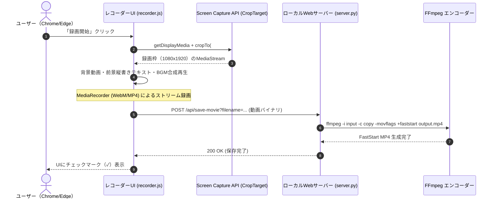

# プロモーション動画システム仕様 (book/promote/specification.md)

本ドキュメントは、書籍宣伝用縦型ショート動画レコーダーのクライアント・サーバーアーキテクチャ、レンダリング幾何学、Web API仕様、動画エンコーディングパイプライン、および素材ライセンスに関する技術仕様書です。


## 1. システムアーキテクチャ概要

本ツールは、HTML5/CSSの表現力（縦書き・ルビ組版・フォントレンダリング）を活かしたショート動画を、ブラウザ完結で高画質にキャプチャし、ローカルサーバー経由でFastStart MP4へ自動変換するシステムです。




## 2. レンダリング幾何学＆アニメーション仕様

### 2.1 録画枠（Stage Frame）の座標系
- **基準解像度**: $1,080 \times 1,920$ ピクセル（アスペクト比 9:16、フルHD縦型規格）
- **ビューポート適応（`fitStage`）**:
  ブラウザの表示領域に合わせて、以下のスケーリングファクターで `#stage-frame` を縮小・中央配置します（録画時は元の1080x1920解像度でキャプチャ）。
  $$\text{scale} = \min\left(\frac{\text{window.innerWidth} - 360}{1080}, \frac{\text{window.innerHeight} - 40}{1920}, 1.0\right)$$

### 2.2 前景テキストスクロールの物理計算
前景テキスト（縦書き）は、画面左外から右外へ一定速度で水平スクロールします。

- **スクロール速度 ($V$)**: $200 \text{ px/sec}$
- **テキストブロック幅 ($W_{\text{text}}$)**: 前景テキストの `offsetWidth`
- **移動距離 ($D$)**: $D = W_{\text{text}} + 1080 \text{ px}$
- **スクロール所要時間 ($T_{\text{scroll}}$)**:
  $$T_{\text{scroll}} = \frac{W_{\text{text}} + 1080}{200} \text{ 秒}$$
- **総録画時間 ($T_{\text{total}}$)**:
  $$T_{\text{total}} = \text{LEAD\_IN} (1.0\text{s}) + T_{\text{scroll}} + \text{LEAD\_OUT} (0.5\text{s})$$


## 3. Web API 仕様 (`server.py`)

ローカルPythonサーバーはマルチスレッドHTTPサーバー（`ThreadingHTTPServer`）としてポート `8000` で待機します。

### 3.1 録画状態確認 API
- **エンドポイント**: `GET /api/movies-status`
- **レスポンススキーマ (JSON)**:
  ```json
  {
    "success": true,
    "files": ["手引き_出版の壁.mp4", "手引き_テーマ選定.mp4"]
  }
  ```

### 3.2 動画保存・FastStart変換 API
- **エンドポイント**: `POST /api/save-movie?filename={filename.mp4}`
- **リクエストヘッダー**: `Content-Type: video/webm` または `video/mp4`, `Content-Length: {size}`
- **リクエストボディ**: 録画された動画のバイナリストリーム（64KB単位でチャンク書込）
- **処理ロジック**:
  1. 一時ファイル `movie/_temp_upload_{filename}` に保存。
  2. FFmpegを実行し、FastStart MP4へストリームコピー変換（無劣化・一瞬で完了）：
     ```sh
     ffmpeg -y -i _temp_upload.mp4 -c copy -movflags +faststart final.mp4
     ```
  3. 一時ファイルを削除。
- **レスポンススキーマ (JSON)**:
  ```json
  {
    "success": true,
    "filename": "手引き_出版の壁.mp4",
    "savedPath": "movie/手引き_出版の壁.mp4"
  }
  ```


## 4. なぜ FastStart (`-movflags +faststart`) が必須か

通常のMP4コンテナは、メタデータ（インデックス情報を含む `moov atom`）がファイル末尾に書き込まれます。
この状態の動画をYouTubeやTikTok、Webサーバーにアップロードすると、クライアントが動画全体をダウンロード完了するまでシーク再生やサムネイル生成を開始できず、再生待機時間（バッファリング）が発生します。
`-movflags +faststart` を適用することで、`moov atom` がファイル先頭に再配置され、**ストリーミング即時再生**が可能になります。


## 5. 素材ライセンス＆利用許諾

| 素材種別 | ファイル名 | 配布元 | 商用利用 | クレジット表記 |
|:---|:---|:---|:---|:---|
| 背景動画 | `223363_夕日.mp4` 等 | [Pixabay](https://pixabay.com/) | **可能** | 不要（著作権フリー） |
| BGM | `296_BPM85_...mp3` | [BGMer](https://bgmer.net/) | **可能** | 不要（商用フリー） |
