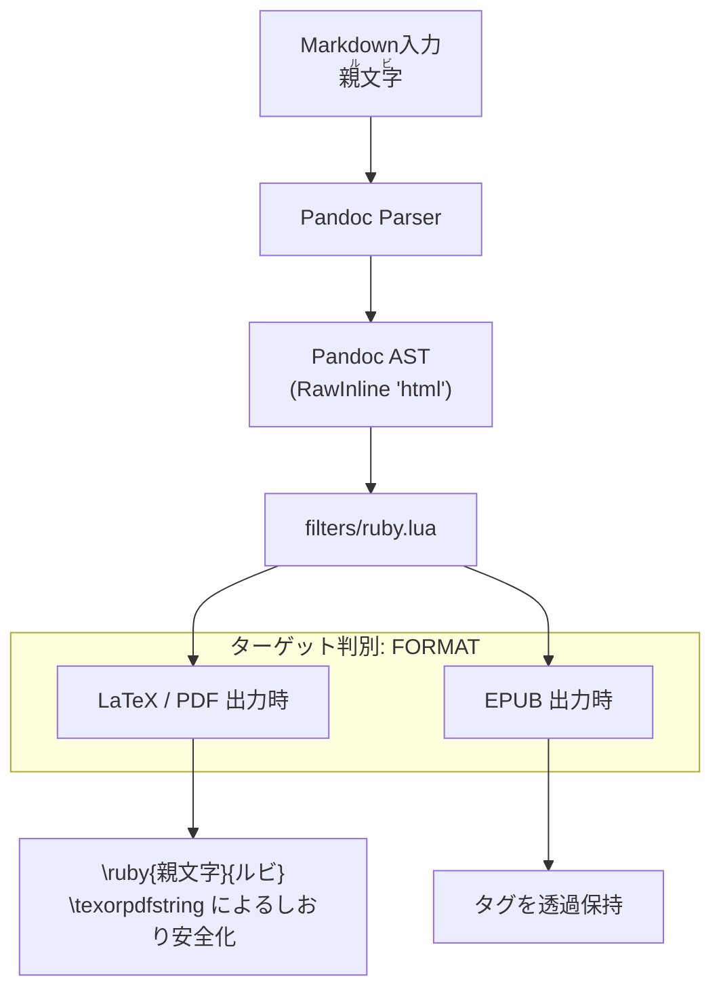

# Pandoc ASTフィルター技術仕様 (filters/specification.md)

本ドキュメントは、Pandocの抽象構文木（AST: Abstract Syntax Tree）走査時に実行されるLuaフィルター（`ruby.lua`）の変換アルゴリズム、ターゲット別マッピング仕様、およびLaTeXマクロ安全化処理に関する技術仕様書です。


## 1. フィルターの目的と位置づけ

Markdownの仕様では、専用記法のない表現をインラインHTMLタグとして記述できることが認められています。本フィルターは、Markdown内に記述された `<ruby>親文字<rt>ルビ</rt></ruby>` をPandoc ASTレベルでインターセプトし、LaTeX（LuaLaTeX + `luatexja-ruby`）形式へ透過的にブリッジする役割を担います（※執筆時は可読性の高い「`漢字（かんじ）`」の全角かっこ書きで執筆し、推敲時にプロンプトで一括変換されたものが本フィルターへ渡されます）。




## 2. インライン要素の走査と変換アルゴリズム (`Inlines`)

`Inlines` フィルタは、インライン要素の配列を走査するステートマシンとして実装されています。

### 2.1 状態遷移ロジック
1. `el.t == "RawInline"` かつ `el.format == "html"` かつ `el.text:match("^<ruby")` を検出。
2. `<rt>` タグが出現するまでの中間インライン要素を `pandoc.utils.stringify` で文字列化し、親文字バッファ（`rb_text`）に蓄積。
3. `</rt>` または `</ruby>` タグが出現するまでの要素をルビバッファ（`rt_text`）に蓄積。
4. 抽出された文字列から `\ruby{親文字}{ルビ}` を構築し、`RawInline("latex", ...)` としてASTへ置換。


## 3. 見出し要素の正規化としおり安全化 (`Header`)

PDF生成時、LaTeXのセクション見出しにマクロ（`\ruby` 等）がそのまま渡されると、**PDFのしおり（アウトライン）および目次（TOC）でLaTeXマクロが展開されず、致命的な文字化けやコンパイルエラー**が発生します。

### 3.1 `\texorpdfstring` による二重化処理
見出し要素（`Header`）が検出された場合、本フィルターは `process_inlines` 関数により「LaTeX描画用文字列（`latex_title`）」と「プレーンテキスト文字列（`plain_title`）」の2系統を同時に生成します。

```lua
-- 生成されるLaTeXブロックの例
\cleartoleftpage
\section[plain_title]{\texorpdfstring{latex_title}{plain_title}}\label{header-id}
```

| 適用先 | 渡される文字列 | 動作仕様 |
|:---|:---|:---|
| **紙面上の見出し描画** | `latex_title` (`\ruby{...}{...}`) | 適切なフォント・級数でルビ付き見出しとして組版 |
| **PDFのしおり（Bookmarks）** | `plain_title` (親文字のみ) | 特殊マクロを除去した平文テキストとして文字化けを防止 |
| **LaTeX目次（TOC）** | `plain_title` (親文字のみ) | 目次行の行送り乱れやオーバーフルを回避 |

### 3.2 日本の出版慣例（左ページ起こし）の制御
- **大見出し（`el.level == 1`）**:
  見出しの直前に `\cleartoleftpage` を自動注入します。これにより、書籍の慣例に従い、章扉が常に偶数ページ（左ページ）から開始されるようページ送りが強制されます。
- **節見出し（`el.level == 2`）**:
  章の内部で連続して読ませるため、改ページを挟まず前後の段落と適切な行間で組版されます。
