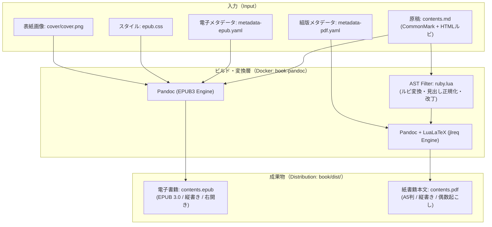

# 出版テンプレート全体仕様 (specification.md)

本ドキュメントは、本出版テンプレートの全体アーキテクチャ、設計思想、システムコンポーネントの責務境界、および実行基盤に関する技術仕様書です。


## 1. システムアーキテクチャ概要

本テンプレートは、**「単一源泉（Single Source of Truth）」** の原則に基づき、1つのMarkdown原稿（`contents.md`）から、Amazon KDP入稿用の電子書籍（EPUB）と紙書籍用印刷PDF（LuaLaTeX）を一貫してビルド・検証するクロスフォーマット・パブリッシング基盤です。




## 2. コンポーネント責務マトリクス

システムを構成する各ディレクトリの技術的責務と境界線は以下の通り定義されます。

| ディレクトリ | レイヤー名 | 技術的責務 | 主要ファイル / 成果物 |
|:---|:---|:---|:---|
| **`./`** | プロジェクトルート | 全体ワークフロー統括、Docker環境定義、入稿管理 | `README.md`, `specification.md`, `submission.md`, `Dockerfile` |
| **`book/`** | コンテンツデータ層 | マスター原稿、企画メモ、書誌メタデータ、組版スタイル | `contents.md`, `memo.md`, `prompt.md`, `metadata-*.yaml`, `epub.css` |
| **`book/cover/`** | 装丁・アセット層 | 電子・紙用表紙画像、公式テンプレート、印刷用見開きPDF | `cover.png`, `cover_for_kdp.jpg`, `cover_to_paperback.pdf` |
| **`book/dist/`** | パブリッシュ成果物層 | KDP入稿用の最終ビルド成果物（EPUB, PDF） | `contents.epub`, `contents.pdf` |
| **`book/promote/`** | 宣伝・レンダリング層 | ブラウザベース動画キャプチャ、ローカル配信サーバー | `recorder/`, `server.py`, `run_server.sh`, `movie/` |
| **`bin/`** | ビルドパイプライン層 | Dockerコンテナ経由での組版スクリプト群、設定永続化 | `md2kdp.sh`, `md2epub.sh`, `md2pdf.sh`, `*.setting` |
| **`filters/`** | AST変換層 | Pandoc抽象構文木に対するルビ変換・LaTeXマクロ生成 | `ruby.lua` |


## 3. ディレクトリ構成

```
.
├── README.md               # 全体ワークフロー案内・環境準備手順
├── specification.md        # 本書（全体技術仕様・アーキテクチャ定義）
├── submission.md           # 3-1: KDP入稿手順 ＆ 出版登録シート
│
├── book/                  # 書籍コンテンツ本体
│   ├── contents.md        # 原稿本文（Markdown形式）
│   ├── memo.md            # 企画・構成検討メモ（AI壁打ち用キャンバス）
│   ├── prompt.md          # AI出版プロンプト集（企画・校正・動画生成）
│   ├── metadata-epub.yaml # 電子書籍（EPUB）用書誌メタデータ
│   ├── metadata-pdf.yaml  # ペーパーバック（PDF）用組版・書誌メタデータ
│   ├── epub.css           # EPUB用縦書きスタイルシート
│   ├── README.md          # 1: 執筆フェーズ手順書
│   ├── specification.md   # 書籍データ仕様書
│   ├── cover/             # 表紙・装丁素材（詳細は cover/specification.md）
│   ├── dist/              # パブリッシュ成果物（contents.epub, contents.pdf）
│   └── promote/           # プロモーションショート動画ツール（詳細は promote/specification.md）
│
├── bin/                   # EPUB/PDF変換スクリプト群
│   ├── md2kdp.sh          # 一括生成スクリプト（Bash）
│   ├── md2epub.sh         # EPUB個別生成スクリプト（Bash）
│   ├── md2pdf.sh          # PDF個別生成スクリプト（Bash）
│   ├── README.md          # 2: 製本フェーズ手順書
│   └── specification.md   # スクリプト動作・設定仕様書
│
├── filters/               # Pandoc用組版フィルター（内部コンポーネント）
│   ├── ruby.lua           # HTMLルビ変換・見出し処理フィルター
│   └── specification.md   # フィルター技術仕様書
│
└── Dockerfile             # 組版（Pandoc/LaTeX）・動画処理（Python/FFmpeg）統合Docker定義
```


## 4. 実行基盤・コンテナ仕様（Infrastructure Specification）

ホストOS（Windows / macOS / Linux）の差異によるフォント欠落、TeXパッケージのバージョン齟齬、エンコーディング差異を根絶するため、すべての実行系はDockerコンテナ内に完全カプセル化されています。

### 4.1 Dockerイメージ構成 (`book-pandoc`)

- **ベースイメージ**: `pandoc/latex:latest`（Alpine Linuxベース）
- **組版エンジン**:
  - Pandoc 3.x
  - LuaLaTeX（`luatexja` パッケージ、`jlreq` ドキュメントクラス）
- **追加ランタイム**:
  - `python3` (v3.11+) : 録画サーバー（`server.py`）実行用
  - `ffmpeg` (v6.x+) : 動画のFastStartコンテナ変換用
- **内包日本語フォント**:
  - `noto-fonts-cjk` (Noto Sans CJK JP, Noto Serif CJK JP)
  - `ipaexfont` / `ipafont` (IPAex明朝, IPAexゴシック, IPA明朝, IPAゴシック)

### 4.2 ボリュームマウントとパス解決

- ホストのプロジェクトルートがコンテナ内の `/workspace` にバインドマウントされます。
- 作業ディレクトリ（`-w`）は常に `/workspace` となり、スクリプト間の相対パスはホスト・コンテナ間で透過的に保たれます。
- 文字コードはUTF-8で統一され、改行コードはLFおよびCRLFの双方がサポートされます（Git Bash推奨）。


## 5. 入出力データ・プロトコル仕様

### 5.1 入力原稿仕様
- **構文標準**: CommonMark準拠Markdown。
- **読み仮名（ルビ）**: Markdown標準構文でサポートされるインラインHTML表現（`<ruby>親文字<rt>ルビ</rt></ruby>`）として組版エンジンへ渡されます（※執筆時は自然で入力しやすい「`漢字（かんじ）`」の全角かっこ書きで執筆し、推敲時にプロンプトで一括変換可能）。
- **章構成規則**:
  - レベル1見出し（`#`）: 大見出し（章タイトル）。LaTeX側で偶数ページ（左ページ）起こしとして組版。
  - レベル2見出し（`##`）: 節見出し。目次（TOC depth: 2）に反映。

### 5.2 入稿成果物マトリクス

| 成果物 | ファイルパス | 準拠規格 | 必須要件 |
|:---|:---|:---|:---|
| **電子書籍データ** | `book/dist/contents.epub` | EPUB 3.2 | 縦書き（`vertical-rl`）、右開き（`page-progression-direction="rtl"`）、表紙埋め込み済 |
| **紙書籍本文データ** | `book/dist/contents.pdf` | PDF 1.5+ | ユーザー設定判型（サンプル初期値: A5判 148×210mm）、縦書き、300dpi相当フォント埋め込み、ノド・小口非対称余白 |
| **電子書籍表紙** | `book/cover/cover_for_kdp.jpg` | JPEG (RGB) | 縦横比 1:1.6、長辺 2,560px 推奨 |
| **紙書籍表紙データ** | `book/cover/cover_to_paperback.pdf` | PDF 1.5+ | 表・背・裏の一体見開き、300.0 DPIベクターPDF、外周0.125インチ裁ち落とし |
